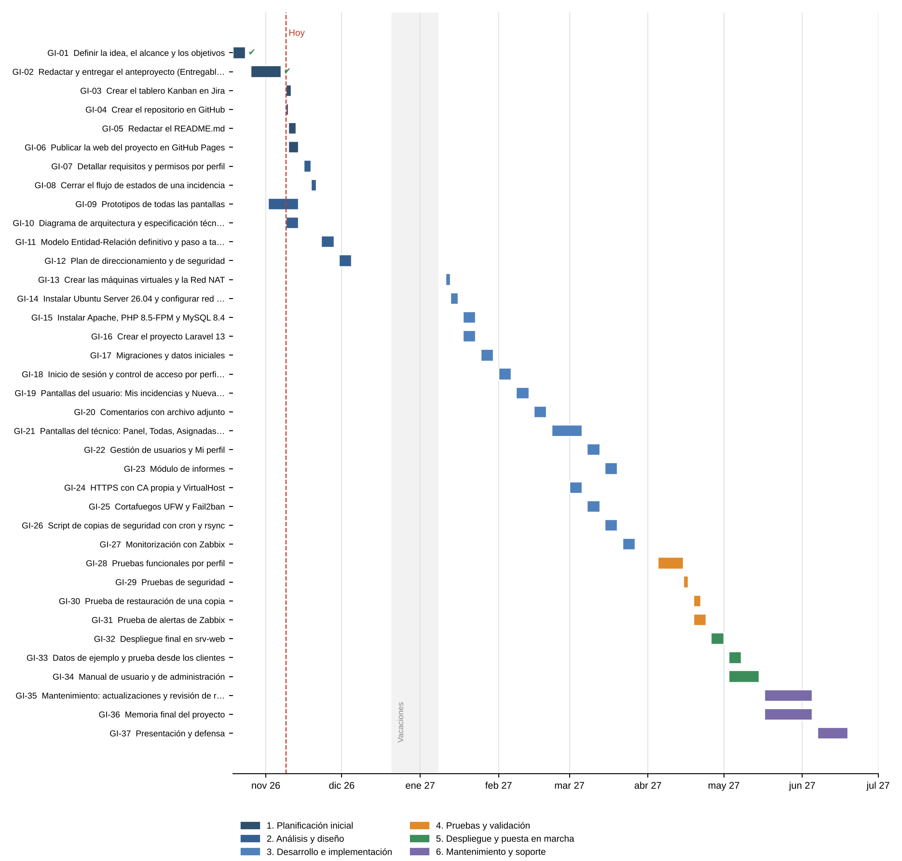
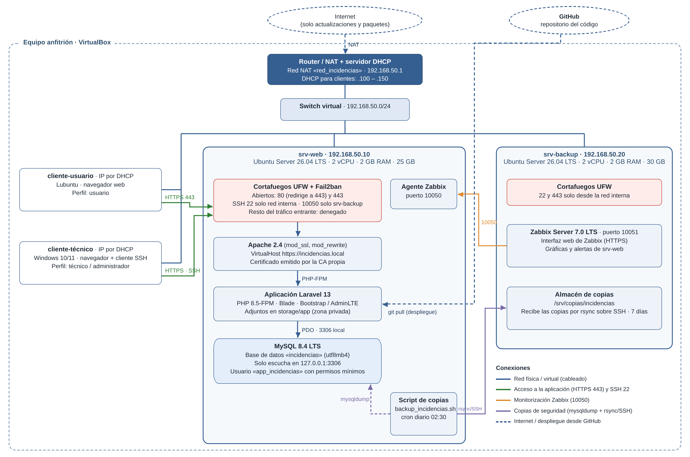

# Sistema web de gestión de incidencias informáticas para pequeñas organizaciones

Proyecto Intermodular · CFGS Administración de Sistemas Informáticos en Red (ASIR) · Curso 2026/2027
Autora: **Elida Martinez López** · Departamento de Informática

**Web del proyecto:** https://elimartinezlopez.github.io/gestor-incidencias/
**Tablero Kanban (Jira):** https://iestriana-team-phdb80bn.atlassian.net/jira/software/projects/KAN/boards/1

---

## 1. Descripción

Aplicación web para **registrar, gestionar y hacer el seguimiento de las incidencias informáticas** de una pequeña organización. Los empleados comunican sus problemas (hardware, software, red, cuentas de usuario, periféricos…) desde un formulario y el personal técnico los clasifica, prioriza, comenta y resuelve, de modo que cada incidencia queda registrada desde que se abre hasta que se cierra.

El proyecto incluye también la **infraestructura** donde se despliega la aplicación: servidor web, base de datos, cortafuegos, HTTPS, copias de seguridad y monitorización.

## 2. Justificación

En las organizaciones pequeñas los problemas informáticos suelen llegar por mensajes, llamadas o de palabra. Esto provoca:

- Incidencias que se pierden o se olvidan.
- Falta de seguimiento: nadie sabe en qué estado está cada problema.
- Ningún historial para consultar cómo se resolvió un problema parecido.

Existen herramientas profesionales (osTicket, GLPI, Zammad, Jira Service Management), pero son demasiado completas o caras para este caso. Este proyecto desarrolla una solución propia, sencilla y de alcance controlado, con una finalidad formativa: trabajar de forma integrada desarrollo web, bases de datos, sistemas, redes, seguridad, copias y monitorización.

## 3. Objetivos

**Objetivo general:** diseñar, desarrollar e implementar un sistema web para registrar, gestionar y hacer el seguimiento de incidencias informáticas en pequeñas organizaciones.

**Objetivos específicos:**

- Autenticación de usuarios con dos perfiles fijos: usuario y técnico/administrador.
- Registro de incidencias con categoría, prioridad, estado y adjuntos.
- Comentarios de seguimiento e historial de cambios de estado.
- Base de datos MySQL diseñada a partir de un modelo Entidad-Relación.
- Despliegue en un servidor Ubuntu Server con Apache y acceso solo por HTTPS.
- Cortafuegos UFW, SSH con clave y Fail2ban.
- Copia de seguridad diaria automatizada y probada.
- Monitorización del servidor y sus servicios con Zabbix.

## 4. Tecnologías

| Ámbito | Tecnologías |
|---|---|
| Backend | PHP 8.5 · Laravel 13 |
| Frontend | HTML · CSS · JavaScript · Blade · Bootstrap 5.3 · AdminLTE 4 |
| Base de datos | MySQL 8.4 LTS |
| Sistema operativo del servidor | Ubuntu Server 26.04 LTS |
| Servidor web | Apache 2.4 con PHP-FPM, mod_ssl y mod_rewrite |
| Seguridad | HTTPS con CA propia (OpenSSL) · UFW · OpenSSH con clave · Fail2ban |
| Copias de seguridad | Bash · cron · mysqldump · rsync sobre SSH |
| Monitorización | Zabbix 7.0 LTS |
| Virtualización | VirtualBox (Red NAT) |
| Clientes | Lubuntu y Windows 10/11 con navegador web |
| Gestión del proyecto | Git · GitHub · GitHub Pages · Jira |

## 5. Funcionalidades principales

**Usuario**
- Iniciar y cerrar sesión.
- Registrar una incidencia y adjuntar una captura o foto del error.
- Consultar sus incidencias y su estado (*Mis incidencias*).
- Comentar sus incidencias, confirmar la solución o reabrirlas.
- Editar su perfil y cambiar la contraseña.

**Técnico / administrador**
- Panel con indicadores (abiertas, en curso, críticas, resueltas).
- Listado de todas las incidencias con filtros y búsqueda.
- Incidencias *Asignadas a mí*.
- Detalle de cada incidencia: asignar técnico, cambiar prioridad y estado, comentarios internos y registro de la solución.
- Gestión de usuarios: alta, edición y desactivación de cuentas.
- Informes por periodo, categoría y técnico.

**Estados de una incidencia:** Abierta → Asignada → En curso → (En espera) → Resuelta → Cerrada.

## 6. Planificación

El trabajo se divide en **6 fases y 37 tareas**, con unas **204 horas** estimadas. El detalle de cada tarea (descripción, dependencias, fechas, estimación y criterio de finalización) está en [docs/planificacion/tareas.md](docs/planificacion/tareas.md).

| Fase | Periodo | Tareas principales |
|---|---|---|
| 1. Planificación inicial | Oct – nov 2026 | Anteproyecto, Jira, repositorio, README y web |
| 2. Análisis y diseño | Nov – dic 2026 | Requisitos y permisos, flujo de estados, prototipos, arquitectura, modelo E-R |
| 3. Desarrollo e implementación | Ene – mar 2027 | Máquinas virtuales, servidor, aplicación Laravel, HTTPS, cortafuegos, copias, Zabbix |
| 4. Pruebas y validación | Abr 2027 | Pruebas funcionales y de seguridad, restauración de copias, alertas |
| 5. Despliegue y puesta en marcha | Abr – may 2027 | Despliegue final, datos de ejemplo, manuales |
| 6. Mantenimiento y soporte | May – jun 2027 | Actualizaciones, memoria final y defensa |



## 7. Estado actual del proyecto

**Fase 1 – Planificación inicial (terminando)** y comienzo de la **fase 2 – Análisis y diseño**.

- Anteproyecto entregado y corregido.
- Prototipos de todas las pantallas y diagrama de arquitectura (en revisión).
- Tablero Kanban de Jira creado con las 37 tareas y compartido con el profesor.
- Repositorio, README y web del proyecto (en curso).
- Desarrollo de la aplicación: previsto a partir de enero de 2027.

## 8. Diseño técnico

**Diagramas** ([docs/diseno/diagramas](docs/diseno/diagramas))
- [Arquitectura e infraestructura](docs/diseno/diagramas/arquitectura.png) · [archivo editable](docs/diseno/diagramas/arquitectura-editable.html)
- [Modelo Entidad-Relación](docs/diseno/diagramas/modelo-entidad-relacion.png) · [archivo editable (Graphviz)](docs/diseno/diagramas/modelo-entidad-relacion.dot)
- [Esquema de red](docs/diseno/diagramas/esquema-red.png) · [archivo editable (Graphviz)](docs/diseno/diagramas/esquema-red.dot)

**Prototipos de interfaz** ([docs/diseno/prototipos](docs/diseno/prototipos), con sus fuentes HTML editables en `fuentes/`)

| Usuario | Técnico |
|---|---|
| [Inicio de sesión](docs/diseno/prototipos/01-inicio-sesion.png) | [Panel](docs/diseno/prototipos/05-tecnico-panel.png) |
| [Mis incidencias](docs/diseno/prototipos/02-usuario-mis-incidencias.png) | [Todas las incidencias](docs/diseno/prototipos/06-tecnico-todas-las-incidencias.png) |
| [Nueva incidencia](docs/diseno/prototipos/03-usuario-nueva-incidencia.png) | [Detalle de incidencia](docs/diseno/prototipos/07-tecnico-detalle-incidencia.png) |
| [Mi perfil](docs/diseno/prototipos/04-usuario-mi-perfil.png) | [Asignadas a mí](docs/diseno/prototipos/08-tecnico-asignadas-a-mi.png) |
| [Cerrar sesión](docs/diseno/prototipos/11-cerrar-sesion.png) | [Usuarios](docs/diseno/prototipos/09-tecnico-usuarios.png) · [Informes](docs/diseno/prototipos/10-tecnico-informes.png) |



## 9. Documentación

- [Anteproyecto actualizado (PDF)](docs/Anteproyecto.pdf)
- [Planificación detallada de tareas](docs/planificacion/tareas.md)
- [Tareas para importar en Jira (CSV)](docs/planificacion/tareas_jira.csv)

## 10. Enlaces

| Recurso | Enlace |
|---|---|
| Página web del proyecto | https://elimartinezlopez.github.io/gestor-incidencias/ |
| Tablero Kanban en Jira | https://iestriana-team-phdb80bn.atlassian.net/jira/software/projects/KAN/boards/1 |
| Repositorio | https://github.com/elimartinezlopez/gestor-incidencias |

## Estructura del repositorio

```
gestor-incidencias/
├── README.md                  ← esta presentación
├── index.html                 ← página web (GitHub Pages)
└── docs/
    ├── Anteproyecto.pdf
    ├── planificacion/         ← tareas, cronograma y CSV para Jira
    └── diseno/
        ├── diagramas/         ← arquitectura, modelo E-R y red (PNG + editables)
        └── prototipos/        ← maquetas de las pantallas (PNG + fuentes HTML)
```
