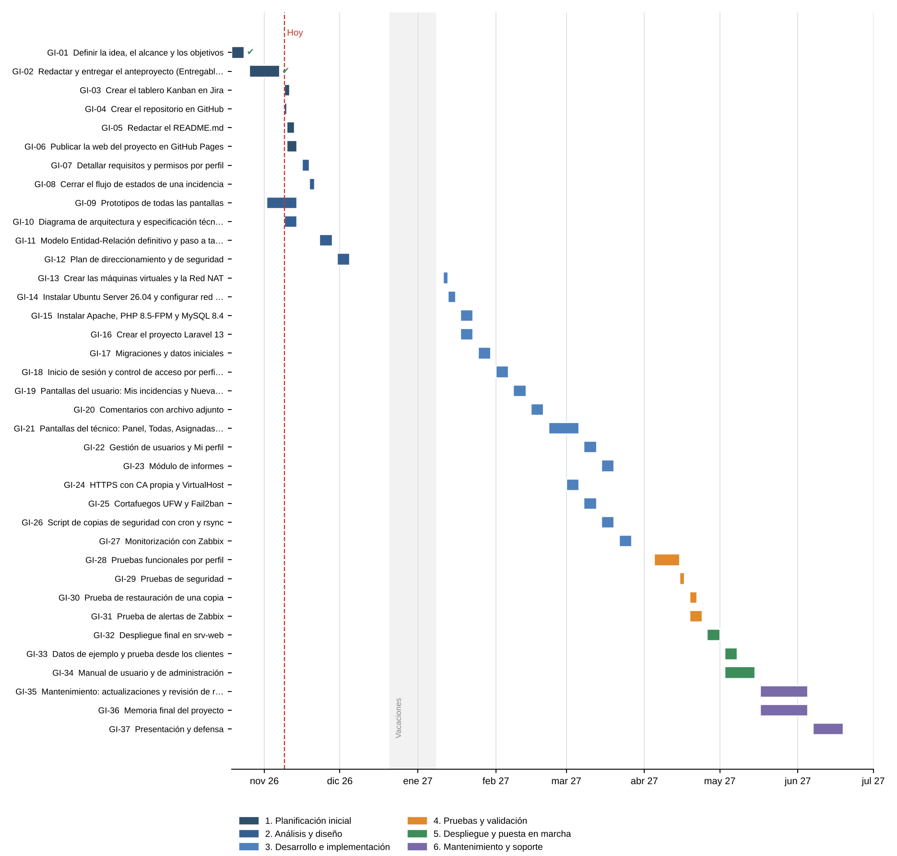

# Planificación de tareas

Total estimado: **204 horas** · 37 tareas · 6 fases.

Los identificadores (GI-xx) son los mismos que aparecen en el tablero de Jira.

## Fase 1. Planificación inicial (33 h)

| ID | Tarea | Descripción | Depende de | Inicio | Fin | Horas | Criterio de finalización | Estado |
|---|---|---|---|---|---|---|---|---|
| GI-01 | **Definir la idea, el alcance y los objetivos** | Elegir el problema a resolver, delimitar qué entra en la primera versión y redactar los objetivos generales y específicos. | — | 19/10/2026 | 23/10/2026 | 6 | Título, descripción, justificación y objetivos redactados en el anteproyecto. | Finalizado |
| GI-02 | **Redactar y entregar el anteproyecto (Entregable 2)** | Completar los once apartados del anteproyecto y corregirlo según los comentarios del profesor. | GI-01 | 26/10/2026 | 06/11/2026 | 14 | Anteproyecto entregado y comentarios del profesor aplicados. | Finalizado |
| GI-03 | **Crear el tablero Kanban en Jira** | Crear el proyecto en Jira con las columnas Pendiente, En curso, En revisión o pruebas y Finalizado, cargar todas las tareas y compartirlo con el profesor. | GI-02 | 09/11/2026 | 10/11/2026 | 3 | Tablero con todas las tareas y enlace accesible para el profesor. | En curso |
| GI-04 | **Crear el repositorio en GitHub** | Crear el repositorio público con su estructura de carpetas (docs, diseño, web) y subir la documentación inicial. | GI-02 | 09/11/2026 | 09/11/2026 | 2 | Repositorio público con la estructura de carpetas y el anteproyecto subido. | En curso |
| GI-05 | **Redactar el README.md** | Presentación resumida del proyecto: descripción, justificación, objetivos, tecnologías, funcionalidades, planificación, estado, diseño y enlaces. | GI-04 | 10/11/2026 | 12/11/2026 | 3 | README con los diez apartados pedidos y todos los enlaces funcionando. | En curso |
| GI-06 | **Publicar la web del proyecto en GitHub Pages** | Página HTML/CSS de presentación del proyecto publicada con GitHub Pages. | GI-04 | 10/11/2026 | 13/11/2026 | 5 | Web accesible desde la URL de GitHub Pages con los enlaces al repositorio y a Jira. | En curso |

## Fase 2. Análisis y diseño (28 h)

| ID | Tarea | Descripción | Depende de | Inicio | Fin | Horas | Criterio de finalización | Estado |
|---|---|---|---|---|---|---|---|---|
| GI-07 | **Detallar requisitos y permisos por perfil** | Listar qué puede hacer el usuario y qué puede hacer el técnico en cada pantalla (matriz de permisos). | GI-02 | 16/11/2026 | 18/11/2026 | 4 | Matriz de permisos revisada y coherente con los prototipos. | Pendiente |
| GI-08 | **Cerrar el flujo de estados de una incidencia** | Definir las transiciones permitidas entre Abierta, Asignada, En curso, En espera, Resuelta y Cerrada, y quién puede hacer cada cambio. | GI-07 | 19/11/2026 | 20/11/2026 | 2 | Diagrama o tabla de transiciones documentado en el repositorio. | Pendiente |
| GI-09 | **Prototipos de todas las pantallas** | Maquetas de cada opción del menú del usuario y del técnico, con su explicación. | GI-01 | 02/11/2026 | 13/11/2026 | 10 | Una maqueta por opción del menú, subida a docs/diseno/prototipos. | En revisión o pruebas |
| GI-10 | **Diagrama de arquitectura y especificación técnica** | Diagrama con servidores, sistemas, servicios, red, IP, cortafuegos, base de datos y clientes, junto con la tabla de componentes. | GI-02 | 09/11/2026 | 13/11/2026 | 4 | Diagrama (editable y PNG) y tabla incluidos en el anteproyecto y en el repositorio. | En revisión o pruebas |
| GI-11 | **Modelo Entidad-Relación definitivo y paso a tablas** | Revisar el modelo E-R y definir tablas, tipos de datos, claves y valores ENUM. | GI-07, GI-08 | 23/11/2026 | 27/11/2026 | 5 | Esquema de tablas listo para crear las migraciones. | Pendiente |
| GI-12 | **Plan de direccionamiento y de seguridad** | Cerrar IP, nombres de máquina, puertos abiertos, reglas de cortafuegos y política de copias. | GI-10 | 30/11/2026 | 04/12/2026 | 3 | Tabla de IP y reglas de cortafuegos documentadas. | Pendiente |

## Fase 3. Desarrollo e implementación (84 h)

| ID | Tarea | Descripción | Depende de | Inicio | Fin | Horas | Criterio de finalización | Estado |
|---|---|---|---|---|---|---|---|---|
| GI-13 | **Crear las máquinas virtuales y la Red NAT** | Crear en VirtualBox la Red NAT red_incidencias y las máquinas srv-web, srv-backup, cliente-usuario y cliente-técnico. | GI-12 | 11/01/2027 | 12/01/2027 | 4 | Las cuatro máquinas se ven entre sí por la red 192.168.50.0/24. | Pendiente |
| GI-14 | **Instalar Ubuntu Server 26.04 y configurar red y SSH** | Instalar el sistema en srv-web y srv-backup, IP fija con Netplan, actualizar y configurar SSH con clave sin acceso root. | GI-13 | 13/01/2027 | 15/01/2027 | 4 | Acceso por SSH con clave a los dos servidores desde cliente-técnico. | Pendiente |
| GI-15 | **Instalar Apache, PHP 8.5-FPM y MySQL 8.4** | Instalar la pila web en srv-web, crear la base de datos y un usuario con permisos solo sobre ella. | GI-14 | 18/01/2027 | 22/01/2027 | 5 | Página de prueba PHP servida por Apache y conexión a MySQL con el usuario de la aplicación. | Pendiente |
| GI-16 | **Crear el proyecto Laravel 13** | Crear el proyecto, configurar .env, Bootstrap y AdminLTE y subirlo al repositorio. | GI-04 | 18/01/2027 | 22/01/2027 | 3 | Proyecto arrancando en local y subido a GitHub. | Pendiente |
| GI-17 | **Migraciones y datos iniciales** | Crear las tablas USUARIOS, INCIDENCIAS, COMENTARIOS e HISTORIAL_ESTADOS con sus claves, y seeders con usuarios de prueba. | GI-11, GI-16 | 25/01/2027 | 29/01/2027 | 5 | php artisan migrate --seed crea la base de datos completa sin errores. | Pendiente |
| GI-18 | **Inicio de sesión y control de acceso por perfil** | Login, cierre de sesión con confirmación y protección de rutas según el perfil (usuario o técnico). | GI-17 | 01/02/2027 | 05/02/2027 | 6 | Cada perfil solo accede a sus pantallas; un usuario no puede abrir rutas del técnico. | Pendiente |
| GI-19 | **Pantallas del usuario: Mis incidencias y Nueva incidencia** | Formulario de registro con validación y listado de las incidencias propias con su estado. | GI-18 | 08/02/2027 | 12/02/2027 | 8 | Un usuario crea una incidencia y la ve en su listado con estado Abierta. | Pendiente |
| GI-20 | **Comentarios con archivo adjunto** | Añadir comentarios (internos o visibles) con un adjunto opcional guardado en la zona privada de Laravel. | GI-19 | 15/02/2027 | 19/02/2027 | 6 | Se suben imágenes y PDF de hasta 5 MB; otros tipos se rechazan. | Pendiente |
| GI-21 | **Pantallas del técnico: Panel, Todas, Asignadas y Detalle** | Panel con indicadores, listados con filtros, detalle de la incidencia, asignación de técnico, cambio de estado e historial. | GI-19 | 22/02/2027 | 05/03/2027 | 14 | Cada cambio de estado queda guardado en HISTORIAL_ESTADOS con fecha y autor. | Pendiente |
| GI-22 | **Gestión de usuarios y Mi perfil** | Alta, edición y desactivación de cuentas (técnico) y edición de datos y contraseña (usuario). | GI-18 | 08/03/2027 | 12/03/2027 | 6 | Una cuenta desactivada no puede iniciar sesión. | Pendiente |
| GI-23 | **Módulo de informes** | Informe por periodo, categoría y técnico con totales, tiempo medio de resolución y gráficas. | GI-21 | 15/03/2027 | 19/03/2027 | 6 | Los datos del informe coinciden con una consulta SQL hecha a mano. | Pendiente |
| GI-24 | **HTTPS con CA propia y VirtualHost** | Crear la CA con OpenSSL, emitir el certificado de incidencias.local, configurar el VirtualHost 443 y redirigir el 80. | GI-15 | 01/03/2027 | 05/03/2027 | 4 | https://incidencias.local abre sin aviso en los clientes y http redirige a https. | Pendiente |
| GI-25 | **Cortafuegos UFW y Fail2ban** | Política de denegar por defecto, abrir solo 80/443, SSH desde la red interna y 10050 desde srv-backup; Fail2ban para SSH. | GI-15 | 08/03/2027 | 12/03/2027 | 3 | ufw status muestra solo las reglas previstas y Fail2ban bloquea tras varios intentos fallidos. | Pendiente |
| GI-26 | **Script de copias de seguridad con cron y rsync** | Script Bash con mysqldump, copia de adjuntos y .env, envío a srv-backup y rotación de 7 días. | GI-15, GI-17 | 15/03/2027 | 19/03/2027 | 5 | La copia aparece cada día en srv-backup y se borran las de más de 7 días. | Pendiente |
| GI-27 | **Monitorización con Zabbix** | Instalar Zabbix Server en srv-backup y el agente en srv-web; plantillas de Linux, Apache y MySQL y alertas. | GI-14 | 22/03/2027 | 26/03/2027 | 5 | Zabbix muestra las gráficas de srv-web y genera una alerta al parar Apache. | Pendiente |

## Fase 4. Pruebas y validación (19 h)

| ID | Tarea | Descripción | Depende de | Inicio | Fin | Horas | Criterio de finalización | Estado |
|---|---|---|---|---|---|---|---|---|
| GI-28 | **Pruebas funcionales por perfil** | Recorrer todas las pantallas con un usuario y con un técnico siguiendo una lista de casos de prueba. | GI-20, GI-21, GI-22, GI-23 | 05/04/2027 | 14/04/2027 | 10 | Todos los casos de prueba superados o con su error registrado en Jira. | Pendiente |
| GI-29 | **Pruebas de seguridad** | Acceso a rutas sin permiso, subida de archivos no permitidos, escaneo de puertos con nmap y prueba de Fail2ban. | GI-24, GI-25, GI-28 | 15/04/2027 | 16/04/2027 | 4 | Ninguna prueba consigue acceder a datos o puertos no permitidos. | Pendiente |
| GI-30 | **Prueba de restauración de una copia** | Restaurar la base de datos y los adjuntos en limpio a partir de una copia de srv-backup. | GI-26 | 19/04/2027 | 21/04/2027 | 3 | La aplicación funciona con los datos restaurados. | Pendiente |
| GI-31 | **Prueba de alertas de Zabbix** | Provocar fallos controlados (parar Apache o MySQL, llenar disco) y comprobar las alertas. | GI-27 | 19/04/2027 | 23/04/2027 | 2 | Cada fallo provocado genera su alerta en Zabbix. | Pendiente |

## Fase 5. Despliegue y puesta en marcha (15 h)

| ID | Tarea | Descripción | Depende de | Inicio | Fin | Horas | Criterio de finalización | Estado |
|---|---|---|---|---|---|---|---|---|
| GI-32 | **Despliegue final en srv-web** | Clonar la versión final desde GitHub, composer install --no-dev, compilar recursos y migrar. | GI-28, GI-29 | 26/04/2027 | 30/04/2027 | 4 | La aplicación funciona en https://incidencias.local con la última versión del repositorio. | Pendiente |
| GI-33 | **Datos de ejemplo y prueba desde los clientes** | Cargar usuarios e incidencias de ejemplo y probar desde cliente-usuario y cliente-técnico. | GI-32 | 03/05/2027 | 07/05/2027 | 3 | Ambos clientes usan la aplicación sin errores. | Pendiente |
| GI-34 | **Manual de usuario y de administración** | Guías con capturas para el usuario, el técnico y el administrador del servidor. | GI-32 | 03/05/2027 | 14/05/2027 | 8 | Manuales subidos al repositorio en docs/manuales. | Pendiente |

## Fase 6. Mantenimiento y soporte (25 h)

| ID | Tarea | Descripción | Depende de | Inicio | Fin | Horas | Criterio de finalización | Estado |
|---|---|---|---|---|---|---|---|---|
| GI-35 | **Mantenimiento: actualizaciones y revisión de registros** | Aplicar actualizaciones de seguridad, revisar registros de Apache y alertas de Zabbix y corregir errores. | GI-32 | 17/05/2027 | 04/06/2027 | 4 | Sistema actualizado y sin errores pendientes en Jira. | Pendiente |
| GI-36 | **Memoria final del proyecto** | Redactar la memoria a partir del anteproyecto, con el desarrollo, las pruebas y las conclusiones. | GI-34 | 17/05/2027 | 04/06/2027 | 15 | Memoria entregada en Moodle. | Pendiente |
| GI-37 | **Presentación y defensa** | Preparar la presentación y la demostración en directo de la aplicación y la infraestructura. | GI-36 | 07/06/2027 | 18/06/2027 | 6 | Presentación preparada y demo ensayada. | Pendiente |
